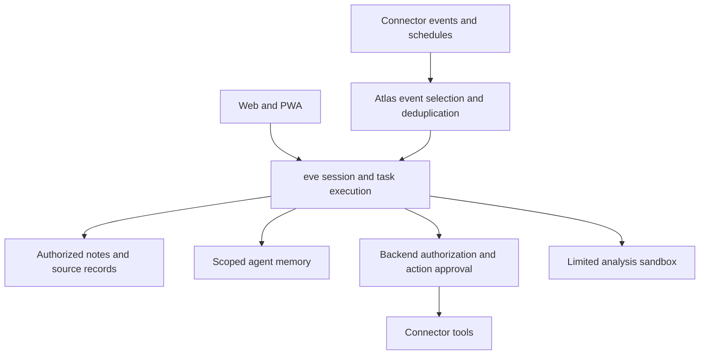

# Architecture discussion baseline

Atlas has a React/TypeScript scaffold with a fixed synthetic source viewer, planning material and static prototypes. This page supersedes the earlier production specification. The isolated eve/OpenRouter experiment below is verified locally; the web application does not yet call an agent backend.

## Direction and open choices

| Area | Status |
| --- | --- |
| Tooling | Vite+ 1.3.0 with pnpm. Commands and verification boundaries are in [development setup](development.md) |
| Agent runtime | eve selected as the direction; a local provider invocation is verified below. Web integration and deployment remain unverified |
| Client | React/TypeScript web scaffold. Web/PWA first remains the direction. PWA setup is not implemented. The exact TanStack/framework arrangement remains for team review |
| Database and ORM | Open; PostgreSQL/Drizzle were proposals, not approved dependencies |
| Auth, file storage, connector provider | Open; compare actual required capabilities and cost |
| API | REST and GraphQL remain options; relationships alone do not require GraphQL |
| Memory provider | Open; file-based and hosted approaches can be tested without requiring a vector DB |
| Model and gateway | OpenRouter verified for the isolated smoke; product model choice and tool quality still need evals |
| Hosting | Vercel direction with existing Pro; exact services and team access unverified |

## First eve entrypoint experiment (#26)

On 24 October 2026, [the isolated experiment](../experiments/eve-openrouter/README.md)
ran on Node 24.22.0 with eve 0.83.0, AI SDK 7.0.152 and OpenRouter provider 3.1.0.
`eve dev --no-ui --no-default-extensions` served only on loopback. The public
`Client` from `eve/client` created a session and sent a synthetic note through
the configured OpenRouter `LanguageModel`, without a Vercel login or deployment.

- Input: `Synthetic note: The Atlas review is on 22 October at 14:00. What time is the review?`
- Actual output: `The review is at 14:00 on 22 October.`
- The final smoke observed `step.completed`, `turn.completed` and the session
  boundary. `waiting` means the reusable session awaits another message.
- Each of two successful calls reported 67 input and 14 output tokens using
  `openai/gpt-4.1-mini`. eve did not report a direct-provider USD cost. OpenRouter's
  key usage updates asynchronously; do not treat an immediate zero delta as free.
  A later key-usage read reported **$0.0000984 total** for the two calls.
- The current server guard requires a dedicated key with a non-resetting
  provider-enforced cap of at most $1, including BYOK spending. These guard
  checks are tested with mocked HTTP separately from the historical live calls.
  Model output is limited to 256 tokens; optional built-in tools
  and development extensions are disabled.

eve supplied agent discovery, the local HTTP/session runtime, model invocation,
and streamed lifecycle/usage events. OpenRouter supplied model routing and billing.
Atlas still owns user authorization, source selection and provenance, product
data, and external-action policy. This experiment has no retrieval or connector
tools and does not prove durability, restart recovery, action safety, or answer quality.

The next decision is which bounded Atlas flow should use this entrypoint, with
its authorization and source contract agreed before connecting the web app.
Another teammate must reproduce the documented run before #26 is complete.

## Responsibility boundaries



Use eve capabilities before implementing a second agent loop, task journal, approval wait, stream resume mechanism, or eval runner. Confirm each capability against the pinned version. Atlas still owns user authorization, source provenance, product data, event selection, and external action outcomes.

A connector tool is not necessarily a sync service. Verify Gmail/Calendar scopes, event delivery, backfill, token refresh, account disconnection, and provider limits before selecting an adapter. Composio is a candidate where native connections leave a gap.

## Data that must stay distinct

- User-authored notes: editable content with clear ownership.
- Source records: provider identity, source link, timestamps, and the authorized content needed for the feature.
- AI-produced notes and claims: labeled as generated, with source references and corrections where applicable.
- Working state: the agent's current plan, task status, and session continuation data.
- Long-term memory: selected cross-session knowledge, subject to access, correction, and deletion.
- Actions: exact intended operation, approval, attempt identity, and observed provider outcome.

These are conceptual responsibilities, not six databases or a finalized schema. Agent memory does not replace the user's source archive.

## Small starting layout

The current single web app lives in root `src/`. No shared packages or backend services exist. The following expansion remains a proposal. Create folders when they contain real code:

```text
apps/web/       PWA and product screens
apps/agent/     eve integration and Atlas backend modules
packages/       Only code genuinely shared by multiple apps
```

Do not pre-create worker, billing, vector, ingestion, or OKF packages. Do not add another workflow system or continuous heartbeat until a concrete gap requires it. Agent state must survive sandbox shutdown. Persist useful artifacts outside disposable compute.

## OKF reminder

The earlier plan treated Google's Open Knowledge Format as a portable, agent-readable export/import bundle, not the live database, retrieval engine, or agent runtime. That portability idea remains a candidate, not a required first-release subsystem.

Before implementation, map Atlas sources, authorship, relations, permissions, and attachment references to the format; define conflict handling and idempotent import. An export must exclude credentials and respect the exporting user's access. Do not promise a lossless round trip without testing it. See the [upstream project](https://github.com/GoogleCloudPlatform/open-knowledge-format).

## Validation before scaffold expansion

1. Client sends a message to eve and resumes after disconnect.
2. Authorized source retrieval cannot cross user boundaries.
3. A connector action waits for approval; rejection prevents execution.
4. A retry after interruption does not duplicate an external effect.
5. Sandbox analysis returns a persisted artifact within cost/time limits.
6. Deterministic tests and a small real-model eval measure the behavior separately.

Start with synthetic data and one useful flow. Add retrieval indexes, OCR, graph views, and extra services only when a measured use case justifies them.

## Primary references

- [eve documentation](https://eve.dev/docs) and [source](https://github.com/vercel/eve)
- [eve evals](https://eve.dev/docs/evals/overview)
- [Vite+](https://viteplus.dev/guide/)
- [Google OAuth lifecycle](https://developers.google.com/identity/protocols/oauth2)

These are implementation references, not evidence that Atlas already integrates them.
